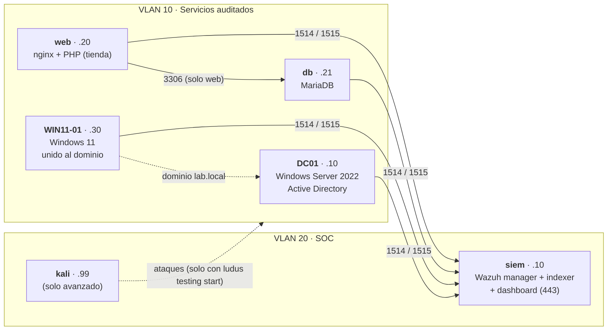

# Laboratorio SIEM sobre Proxmox + Ludus

Práctica académica para **desplegar con código** un laboratorio de seguridad
(SIEM, Active Directory, clientes, servidor web y base de datos), **comprobar su
estado** y **auditarlo** con Wazuh. Todo el laboratorio se define en un archivo
YAML y se levanta con tres comandos.

> **Aviso de uso.** El laboratorio incluye una aplicación web vulnerable a
> propósito y, en el itinerario avanzado, una máquina atacante. Úsalos **solo
> dentro del rango aislado de Ludus** y siempre con el modo de pruebas activo
> (`ludus testing start`). No publiques la aplicación ni ataques sistemas que no
> sean tuyos. Lee [docs/05-uso-responsable.md](docs/05-uso-responsable.md).

## Qué vas a montar



| Componente | Función | RAM |
| --- | --- | --- |
| `siem` | Wazuh: recoge, analiza y muestra los eventos | 8 GB |
| `DC01` | Controlador de dominio `lab.local` | 4 GB |
| `web` | nginx + PHP con una tienda de ejemplo (vulnerable a propósito) | 2 GB |
| `db` | MariaDB con datos ficticios | 2 GB |
| `WIN11-01` | Cliente Windows 11 del dominio | 4 GB |
| `kali` *(solo avanzado)* | Máquina atacante | 4 GB |

Itinerario básico ≈ 20 GB de RAM por alumno; avanzado ≈ 24 GB.

## Dos itinerarios, una misma infraestructura

| | Básico (FP / nivel inicial) | Avanzado (Grado / Máster) |
| --- | --- | --- |
| Carpeta | [`itinerario-basico/`](itinerario-basico/practica.md) | [`itinerario-avanzado/`](itinerario-avanzado/practica.md) |
| Rango | `range-config-basico.yml` | `range-config-avanzado.yml` (añade Kali) |
| Qué haces | Desplegar, comprobar estado, leer el panel, auditar configuración, informe | Todo lo anterior + 5 ataques controlados, rastrear cada uno hasta su alerta, reglas propias, endurecimiento y re-prueba |
| Duración orientativa | 1–2 sesiones (3–4 h cada una) | 3–4 sesiones |
| Evaluación | [`rubrica-basico.md`](plantillas/rubrica-basico.md) | [`rubrica-avanzado.md`](plantillas/rubrica-avanzado.md) |

### ¿Solo tienes 16 GB de RAM?
Hay un **perfil lite** (`range-config-lite.yml`) que mantiene el SIEM, el Active
Directory, el servidor web y la base de datos en ≈ 12 GB de VMs, pensado para un
equipo **dedicado** de 16 GB y solo para el itinerario básico. Ver
[docs/06-perfil-lite.md](docs/06-perfil-lite.md). No es adecuado dentro de un Mac
ni para el itinerario avanzado.

## Cómo se organiza el repositorio

```
docs/                      Guías: conceptos, docente, autoalojada, arquitectura, problemas, perfil lite, instalación en físico
rango/                     range-config-*.yml y los 4 roles de Ansible del laboratorio
itinerario-basico/         Práctica guiada paso a paso
itinerario-avanzado/       Práctica con ataques y detección
plantillas/                Informe de auditoría y rúbricas
scripts/                   preparar-config.sh · instalar-roles.sh · verificar-laboratorio.sh
VERIFICACION-PENDIENTE.md  Lo que NO se ha podido probar aún y cómo comprobarlo
```

## ¿Dónde ejecutarlo?

El servidor del laboratorio necesita un equipo **x86_64 con virtualización** (VT-x o
AMD-V), conectado **por cable**, y corre **Debian 12/13 o Proxmox 8/9**.

| Opción | ¿Recomendada? | Cuándo |
| --- | --- | --- |
| **Debian 13 en un equipo físico** | ✅ **Sí** | Montas el servidor desde cero. Es lo que recomienda Ludus: el instalador añade Proxmox encima |
| **Proxmox VE 9 en un equipo físico** | ✔ Válida | Ya tienes un Proxmox, o quieres ZFS con varios discos. Ludus avisa de posibles choques con configuraciones previas |
| Servidor dedicado o instancia «metal» en la nube | ✔ Válida | No tienes hardware. Ludus soporta bare metal alquilado y algunas instancias de AWS, Azure y Google Cloud |
| Una máquina virtual (VMware Fusion, VirtualBox, Hyper-V…) | ⚠ No recomendada | Requiere virtualización anidada y es más lenta. No sirve en un Mac con Apple Silicon |
| Equipo de 16 GB | ⚠ Experimental | [Perfil lite](docs/06-perfil-lite.md), solo itinerario básico |

**Recomendación:** un equipo físico dedicado con **Debian 13**. Paso a paso, con las
dos variantes (Debian o Proxmox), en
[docs/07-instalar-en-fisico.md](docs/07-instalar-en-fisico.md).

**Hardware orientativo** (según los requisitos de Ludus): CPU con Passmark > 6000,
**32 GB de RAM por rango desplegado**, 200 GB de disco para las plantillas más 50 GB por rango
(mejor NVMe) y red por cable.

## Por dónde empezar

| Eres… | Lee |
| --- | --- |
| **Docente** que monta el servidor para la clase | [docs/07-instalar-en-fisico.md](docs/07-instalar-en-fisico.md) y [docs/01-guia-docente.md](docs/01-guia-docente.md) |
| **Alumno** con un usuario de Ludus ya creado | [docs/00-conceptos.md](docs/00-conceptos.md) y tu itinerario |
| **Alumno** que lo monta en su propio equipo | [docs/07-instalar-en-fisico.md](docs/07-instalar-en-fisico.md) y [docs/02-guia-autoalojada.md](docs/02-guia-autoalojada.md) |

## Despliegue en tres comandos

Con el CLI de `ludus` autenticado (detalles en las guías):

```bash
scripts/instalar-roles.sh                       # registra los 4 roles en Ludus
scripts/preparar-config.sh basico               # genera claves y rango/range-config-basico.local.yml (o avanzado, o lite)
ludus range config set -f rango/range-config-basico.local.yml
ludus range deploy                              # 40-90 min la primera vez
ludus range logs -f                             # sigue el despliegue
```

Cuando `ludus range status` muestre `SUCCESS`, ejecuta
`scripts/verificar-laboratorio.sh` para el informe de estado.

## Estado del proyecto

Los `range-config` están **validados contra el esquema oficial de Ludus**, los
roles pasan `ansible-playbook --syntax-check` y los scripts pasan `shellcheck`.
**Aún no se ha desplegado en un Ludus real.** Antes de usarlo con alumnos, el
docente debe completar [VERIFICACION-PENDIENTE.md](VERIFICACION-PENDIENTE.md).

## Licencia

Código y documentación bajo licencia MIT ([LICENSE](LICENSE)). Wazuh, Ludus,
Proxmox y Windows se rigen por sus propias licencias. Las plantillas de Windows
que construye Ludus usan versiones de evaluación que caducan.
