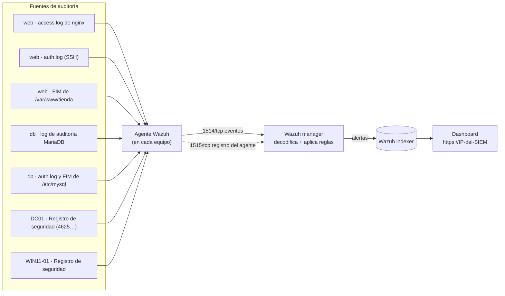
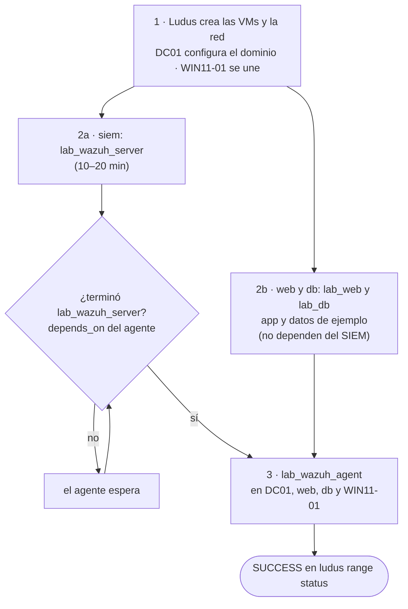

# 03 · Arquitectura

## Redes y direcciones

Ludus asigna a cada alumno una red `10.<N>.0.0/16` propia (el segundo octeto
`<N>` depende del alumno). Dentro de ella:

| VLAN | Uso | Máquina | Último octeto | IP de ejemplo (N = 2) |
| --- | --- | --- | --- | --- |
| 20 | SOC | `siem` | .10 | 10.2.20.10 |
| 20 | SOC | `kali` (avanzado) | .99 | 10.2.20.99 |
| 10 | Servicios | `DC01` | .10 | 10.2.10.10 |
| 10 | Servicios | `web` | .20 | 10.2.10.20 |
| 10 | Servicios | `db` | .21 | 10.2.10.21 |
| 10 | Servicios | `WIN11-01` | .30 | 10.2.10.30 |

Averigua tu `N` real con `ludus range status` (columna *RANGE NETWORK*).
Entre VLAN el tráfico está permitido (comportamiento por defecto de Ludus), de
modo que la Kali llega a las máquinas de servicios.

### ¿Cómo sabe cada agente dónde está el SIEM?
El rol `lab_wazuh_agent` calcula la IP: toma `10.<N>` de la variable
`ludus_dns_server` que Ludus pasa a todos los roles (siempre es `10.<N>.<vlan>.254`)
y le añade la VLAN y el octeto del SIEM de `global_role_vars`. Si algo falla,
puedes forzarla con `lab_siem_ip` en `role_vars`.

## Flujo de datos de auditoría

## Orden de despliegue (lo gestiona `depends_on`)

1. Se crean las VMs y la red; Ludus configura el dominio en `DC01` y une `WIN11-01`.
2. En paralelo: el SIEM instala Wazuh (`lab_wazuh_server`, 10–20 min) y `web` y
   `db` instalan sus servicios (`lab_web`, `lab_db`).
3. El rol `lab_wazuh_agent` de **cada** VM espera a que `lab_wazuh_server` termine
   (`depends_on`). En `web` y `db` se ejecuta además **después** de su rol de
   servicio, para registrar ya los logs de nginx y MariaDB. Sin `depends_on` un
   agente intentaría registrarse antes de que el manager exista.

## Qué decisiones de diseño merece la pena discutir

| Decisión | Motivo |
| --- | --- |
| SIEM en una **VM**, no en LXC | Wazuh interactúa con el kernel (auditoría, descriptores de archivo). Un LXC comparte el del host y da problemas de permisos y de "too many open files" |
| SIEM sin instantánea (`snapshot: false`) | Al salir del modo de pruebas las víctimas se restauran pero las alertas se conservan |
| Web y BD en **VMs separadas** | Permite auditar el acceso entre capas y que la BD solo acepte conexiones del web |
| Roles **propios** de Wazuh | Instalan solo desde `packages.wazuh.com`; no se ejecuta código de terceros como root |
| Versión de Wazuh **fijada** | El agente debe ser ≤ que el manager; todo se documenta contra la misma versión (4.14) |

## Mapa de detección (avanzado)
Cada ataque del itinerario avanzado debe poder rastrearse hasta una alerta. Las
**reglas esperadas** salen de las reglas estándar de Wazuh y deben confirmarse
en tu versión (ver [VERIFICACION-PENDIENTE.md](../VERIFICACION-PENDIENTE.md)).

| # | Ataque (desde Kali) | Host | Dónde queda el rastro | Regla esperada | MITRE |
| --- | --- | --- | --- | --- | --- |
| 1 | Escaneo de directorios web | web | `access.log` de nginx (muchos 404) | grupo `web` (31xxx) | T1595 |
| 2 | Fuerza bruta SSH | web | `/var/log/auth.log` | 5710 / 5712 | T1110 |
| 3 | Inyección SQL en `q=` y en el login | web | `access.log` | 31103 | T1190 |
| 4 | Password spraying contra el dominio | DC01 | Registro de seguridad, evento 4625 | 60122 / 60204 | T1110.003 |
| 5 | Modificar `/var/www/tienda/index.php` | web | FIM (syscheck) | 550 / 554 | T1565 |

**Lo que NO se promete:** Kerberoasting, DCSync u otros ataques de identidad.
Requieren cuentas con SPN, auditoría avanzada de Kerberos y Sysmon, que este
laboratorio no configura. Ver "Ampliaciones" en el itinerario avanzado.

## Lo que Wazuh no ve por defecto
- Posiblemente, los eventos de la **BD**: el log de auditoría de MariaDB se
  recoge como texto, pero **puede que** Wazuh no tenga un decodificador para ese
  formato (compruébalo con `wazuh-logtest`, ver
  [VERIFICACION-PENDIENTE.md](../VERIFICACION-PENDIENTE.md)). Si no lo tiene,
  aparecerá como evento sin alerta, lo que sirve para el ejercicio de escribir
  una regla propia.
- El **tráfico de red**: no hay IDS de red (Suricata/Zeek) en este laboratorio.

## Itinerario servicios (Proxmox sin Ludus)

Diagramas: [arquitectura y flujo de auditoría](diagramas/arquitectura-servicios.html) ·
[mapa de red](diagramas/mapa-red-servicios.html). Despliegue: [08-proxmox-nativo.md](08-proxmox-nativo.md).

| VM | Red | IP | Qué lleva al desplegar |
| --- | --- | --- | --- |
| `siem` | `soc` | 10.20.20.10 | Wazuh (manager + indexer + dashboard) |
| `srv` | `nat` + `testlab` | 22.44.77.250 · 10.20.30.250 | Webmin, agente (logs de Apache + FIM de `/etc/bind`, `/etc/dhcp`, `/etc/samba`, `/etc/apache2`, `/etc/ldap`, `/etc/webmin`, `/etc/iptables`) |
| `ns2` | `testlab` | 10.20.30.249 | Webmin, agente (FIM de `/etc/bind`, `/etc/webmin`) |
| `cliente` | `testlab` | 10.20.30.5 | Webmin, agente (FIM de `nsswitch.conf`, `/etc/pam.d`, `nslcd.conf`), `dig`, `smbclient`, `ldap-utils`, `nmap` |

Los servicios los monta el alumno con Webmin; el agente ya está esperando sus logs. named,
dhcpd, slapd, smbd (con `logging = syslog`), Webmin y el kernel (iptables `LOG`) llegan por el
**journal de systemd**, que el agente de Wazuh 4.14 lee por defecto en Debian 12 (comprobado: su
`ossec.conf` solo trae `journald`, `dpkg.log` y los logs de Apache que añade el rol). rsyslog
deja además copia en `/var/log/syslog` y `/var/log/auth.log`, que es donde el alumno las busca. Wazuh trae reglas de serie para named, slapd, smbd, Apache, iptables, PAM y
FIM; **no** para dhcpd ni Webmin, que son el material del ejercicio de regla propia.

| Decisión | Motivo |
| --- | --- |
| Sin Ludus, solo API de Proxmox + Ansible | El centro tiene un Proxmox VE 9 y no hace falta otra capa; todo sigue siendo código |
| SDN zona simple, IP fijas por cloud-init | Sin DHCP del SDN, que exigiría instalar `dnsmasq` en el host |
| `testlab` sin IP del host | Es la red host-only del PDF: solo se sale por `srv`, y configurar ese router es el primer ejercicio |
| `srv` con dos NIC | Router real, como en el PDF (Ludus solo permitía una NIC por VM) |
| Router temporal solo durante el despliegue | `ns2` y `cliente` necesitan Internet para instalar Webmin y el agente; el alumno empieza de cero |
| Modo de pruebas = `srv` y `siem` sin ruta por defecto (+ nota en la VM) | Corta Internet sin instantáneas ni cortafuegos del clúster. Quitar el SNAT de la subred no sirve (la regla iptables sigue en el nodo). Límite: lo deshace quien tenga `sudo` en `srv` o un reinicio |
